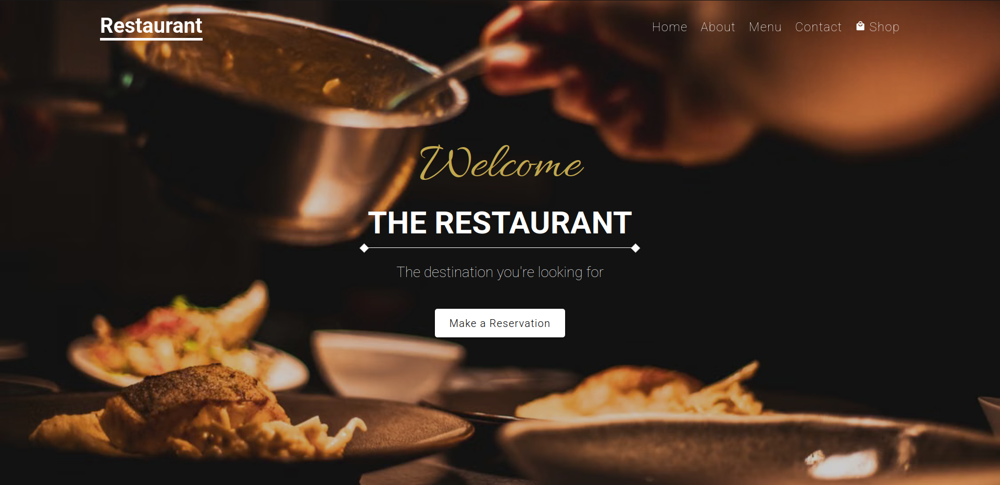
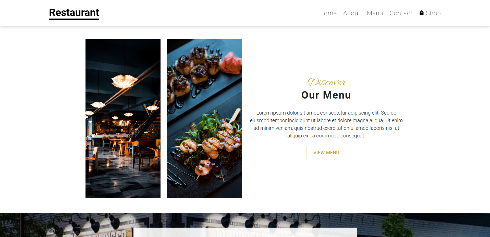

# 🍽️ Restaurant Website Template

A modern, responsive restaurant website template built with **Gatsby.js and React.js**. Designed to provide a comprehensive starting point for developing restaurant websites, featuring a clean architecture, reusable components, and a modern UI.

<p align="center">
    
    
</p>

## ✨ Features

- **Modern UI:** Clean and intuitive user interface.
- **Responsive Design:** Optimized for desktop, tablet, and mobile devices.
- **Component-Based Architecture:** Reusable React components for easier maintenance and customization.
- **Material UI:** Modern UI components and icons powered by Material UI.
- **State Management:** Centralized state management using Redux Toolkit.
- **Date & Time Components:** Date picker functionality powered by MUI X and Day.js.
- **SEO Support:** React Helmet integration for managing page metadata.
- **Fast Performance:** Static site generation and optimized rendering with Gatsby.

## 🛠️ Tech Stack

- **Framework:** Gatsby.js 5
- **Frontend:** React.js 18
- **UI Library:** Material UI (MUI)
- **Styling:** Emotion
- **State Management:** Redux Toolkit
- **Date Utilities:** Day.js
- **SEO:** React Helmet
- **Language:** JavaScript

## 🚀 Getting Started

Follow these steps to run the project locally.

### Prerequisites

Ensure you have the following installed:

- [Node.js](https://nodejs.org/)
- npm (included with Node.js)

### 1. Clone the Repository

```bash
git clone https://github.com/pseudo-elements/gatsby-restuarant-template.git
```

### 2. Navigate to the Project Directory

```bash
cd gatsby-restuarant-template
```

### 3. Install Dependencies

```bash
npm install
```

### 4. Start the Development Server

```bash
npm run develop
```

Open your browser and navigate to:

```text
http://localhost:8000
```

The website will automatically reload as you make changes to the source files.

## 📦 Available Scripts

| Command | Description |
|---|---|
| `npm run develop` | Starts the Gatsby development server. |
| `npm run build` | Generates an optimized production build. |
| `npm run serve` | Serves the production build locally. |
| `npm run clean` | Clears Gatsby's generated cache and files. |
| `npm start` | Starts the development server. |

## 📁 Project Structure

```text
gatsby-restuarant-template/
├── lib/
│   └── data/             # Project data
├── src/                  # Application source code
├── static/               # Static assets
├── gatsby-browser.js     # Gatsby browser configuration
├── gatsby-config.js      # Gatsby site configuration
├── gatsby-ssr.js         # Server-side rendering configuration
├── package.json          # Project dependencies and scripts
└── README.md             # Project documentation
```

## 🎨 Customization

You can adapt the template to your restaurant's branding and requirements.

- Update text, images, and other content to reflect your restaurant.
- Customize colors, typography, and styling to match your brand identity.
- Modify existing React components and pages to suit your needs.
- Update site metadata and configuration in `gatsby-config.js`.
- Extend functionality by integrating additional APIs and services.

## 🏗️ Production Build

To generate an optimized production-ready version of the website, run:

```bash
npm run build
```

Gatsby will generate the production files in the `public/` directory.

## 📄 License

This project is licensed under the **0BSD License**. See the [LICENSE](LICENSE) file for details.


---

**Built with Gatsby.js and React.js ❤️**